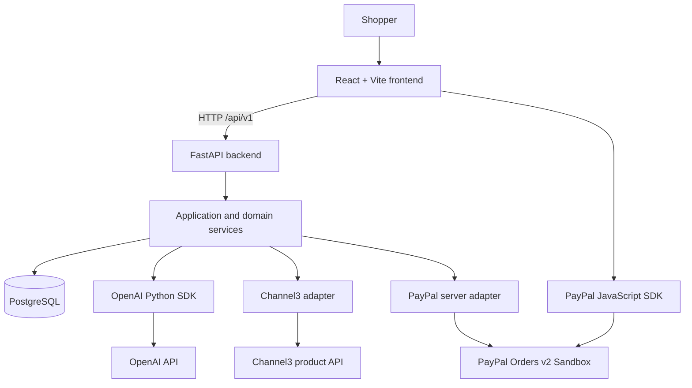
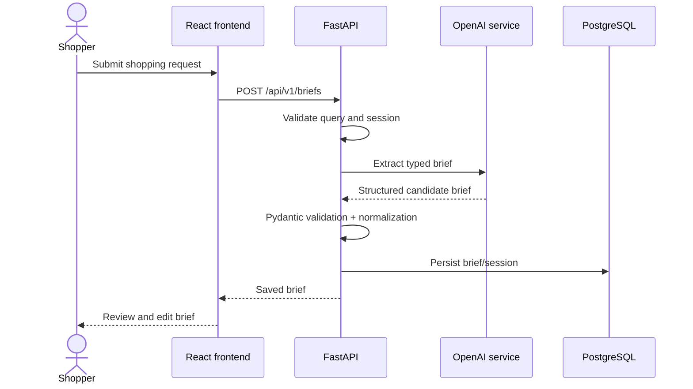
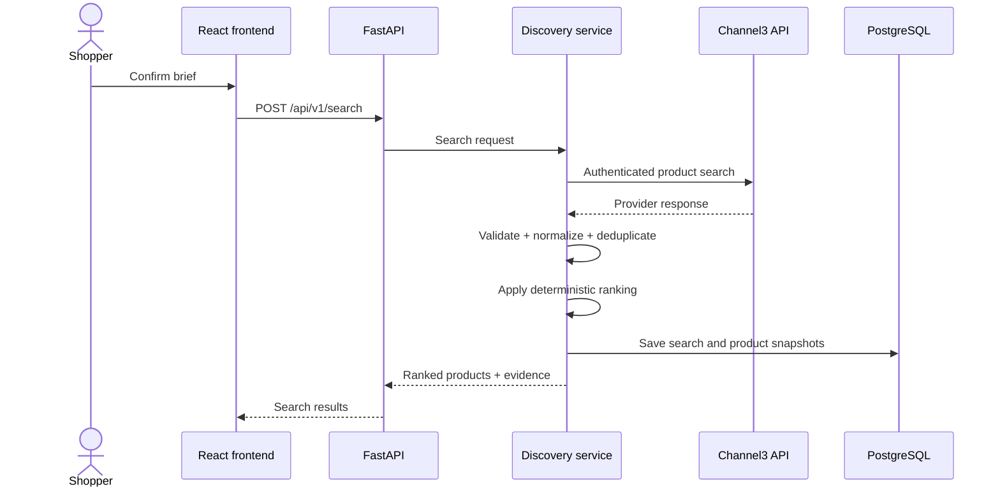

# BuyNexa — Architecture and Engineering Plan

> **Architecture:** Modular monolith / single-repository, two-application layout  
> **Frontend:** React + TypeScript + Vite  
> **Backend:** Python + FastAPI  
> **Database:** PostgreSQL  
> **Primary integrations:** OpenAI, Channel3, PayPal Orders v2 (Sandbox)  
> **Last updated:** 10 November 2026

---

## 1. Architecture goals

1. Deliver a complete, repeatable shopping-to-payment experience in one repository.
2. Keep the frontend and backend clearly separated while sharing a single version-controlled project.
3. Use FastAPI for all backend APIs, business logic, AI orchestration, database access and provider integrations.
4. Use React + Vite for the browser application and PayPal customer approval UI.
5. Make Channel3 a genuine product-data integration behind a replaceable Python adapter.
6. Make PayPal a working, server-controlled checkout integration: create order, customer approval, capture, verify and persist.
7. Keep AI away from payment authority, price calculation and order-state decisions.
8. Make product ranking deterministic and independently testable.
9. Make the project approachable for a solo developer and coding agent.
10. Keep infrastructure simple; avoid premature distributed systems.

### Non-goals

- Next.js, Next.js Route Handlers, Server Actions or a Node.js backend.
- Separate repositories for frontend and backend.
- Microservices, Kubernetes, queues, Redis or vector search for the initial MVP.
- Real-money transactions or live merchant fulfilment.
- Autonomous purchases.
- Retailer scraping or third-party checkout impersonation.

---

## 2. System context and trust boundaries



### Trust boundaries

- **Browser:** untrusted. It may submit a query, brief edits, product IDs from its session, demo SKUs, quantities and PayPal order identifiers. None of these values are authoritative prices or payment states.
- **FastAPI server:** validates all input, owns business rules, accesses secrets, calls external APIs and persists verified state.
- **AI model:** untrusted decision-support component. Its output and tool arguments must be schema-validated and bounded.
- **Channel3 product data:** external data, not executable instructions. Product titles/descriptions may contain malicious or irrelevant text.
- **PayPal:** payment provider source of truth for order/capture status. The application must verify provider responses before displaying success.

---

## 3. Stack decisions

| Concern | Technology | Decision notes |
|---|---|---|
| Frontend framework | React + TypeScript | UI only; no server-side business logic |
| Frontend tooling | Vite | Dev server, HMR and optimized static build |
| Styling | Tailwind CSS | Responsive, consistent design system |
| UI components | shadcn/ui selectively | Accessible primitives; avoid unnecessary component bloat |
| Frontend forms | React Hook Form + Zod where useful | Client-side usability validation; backend remains authoritative |
| Backend framework | FastAPI | REST API, dependency injection, OpenAPI and async endpoints |
| Backend language | Python 3.12+ (prefer a version supported by all selected packages) | Pin exact runtime in project config |
| Backend models/settings | Pydantic v2 + pydantic-settings | Runtime validation and environment configuration |
| Database | PostgreSQL | Durable sessions, briefs, products, carts and orders |
| ORM | SQLAlchemy 2.x | Prefer async engine/session with asyncpg if every selected dependency supports it cleanly |
| Migrations | Alembic | Versioned database schema migrations |
| Python package manager | uv | Lockfile and reproducible environment |
| AI | Official OpenAI Python SDK | Structured outputs and bounded tool calling |
| Product discovery | Channel3 API | Server-side adapter using documented API contract |
| Payments | PayPal JavaScript SDK + Orders v2 | Browser approval, server-side create/capture |
| HTTP client | HTTPX | Async provider requests and testable transport boundaries |
| Backend tests | pytest + pytest-asyncio + HTTPX | Unit, integration and API tests |
| Frontend tests | Vitest + Testing Library | Component and browser logic tests |
| E2E tests | Playwright | Full user journeys |
| Frontend package manager | pnpm | Lockfile in `frontend/` |
| Backend package manager | uv | `pyproject.toml` and `uv.lock` in `backend/` |
| Deployment | One repository; same-origin deployment preferred | Static frontend can be served behind/alongside FastAPI or routed through a reverse proxy |

### Runtime and async decisions

- Use FastAPI `APIRouter` modules grouped by domain.
- Use async FastAPI route handlers for network and database I/O.
- Use SQLAlchemy's async engine/session with an async-compatible PostgreSQL driver when the selected ORM usage is genuinely asynchronous.
- Do not mix synchronous and asynchronous database sessions casually. Pick one consistent pattern and document any sync-only dependency.
- Keep CPU-heavy work out of the event loop. The MVP does not require a task queue.
- Use FastAPI lifespan for startup/shutdown resources where appropriate. Avoid opening a new database connection per request outside the SQLAlchemy session lifecycle.

---

## 4. Single-repository folder structure

```text
buynexa/
├── frontend/
│   ├── public/
│   ├── src/
│   │   ├── app/                 # route composition / page-level views
│   │   ├── components/
│   │   │   ├── ui/
│   │   │   ├── layout/
│   │   │   ├── brief/
│   │   │   ├── shopping/
│   │   │   ├── comparison/
│   │   │   └── checkout/
│   │   ├── features/
│   │   │   ├── briefs/
│   │   │   ├── discovery/
│   │   │   ├── comparison/
│   │   │   ├── cart/
│   │   │   └── payments/
│   │   ├── lib/
│   │   │   ├── api-client.ts
│   │   │   ├── query-client.ts
│   │   │   └── utils.ts
│   │   ├── types/
│   │   ├── App.tsx
│   │   └── main.tsx
│   ├── index.html
│   ├── package.json
│   ├── pnpm-lock.yaml
│   ├── tsconfig.json
│   └── vite.config.ts
├── backend/
│   ├── app/
│   │   ├── main.py
│   │   ├── api/
│   │   │   ├── deps.py
│   │   │   └── v1/
│   │   │       ├── router.py
│   │   │       └── endpoints/
│   │   │           ├── health.py
│   │   │           ├── briefs.py
│   │   │           ├── agent.py
│   │   │           ├── search.py
│   │   │           ├── compare.py
│   │   │           ├── catalog.py
│   │   │           ├── cart.py
│   │   │           ├── paypal.py
│   │   │           └── orders.py
│   │   ├── core/
│   │   │   ├── config.py
│   │   │   ├── logging.py
│   │   │   ├── errors.py
│   │   │   └── security.py
│   │   ├── db/
│   │   │   ├── base.py
│   │   │   ├── session.py
│   │   │   └── models/
│   │   ├── schemas/
│   │   │   ├── brief.py
│   │   │   ├── product.py
│   │   │   ├── cart.py
│   │   │   └── payment.py
│   │   ├── features/
│   │   │   ├── briefs/
│   │   │   │   ├── service.py
│   │   │   │   └── repository.py
│   │   │   ├── discovery/
│   │   │   │   ├── service.py
│   │   │   │   ├── ranking.py
│   │   │   │   └── comparison.py
│   │   │   ├── agent/
│   │   │   │   ├── service.py
│   │   │   │   └── tools.py
│   │   │   ├── cart/
│   │   │   │   ├── service.py
│   │   │   │   └── repository.py
│   │   │   └── payments/
│   │   │       ├── service.py
│   │   │       └── state.py
│   │   ├── integrations/
│   │   │   ├── openai/
│   │   │   │   ├── client.py
│   │   │   │   └── prompts/
│   │   │   ├── channel3/
│   │   │   │   ├── client.py
│   │   │   │   ├── schemas.py
│   │   │   │   └── mapper.py
│   │   │   └── paypal/
│   │   │       ├── client.py
│   │   │       ├── oauth.py
│   │   │       ├── orders.py
│   │   │       └── schemas.py
│   │   └── utils/
│   │       ├── money.py
│   │       ├── ids.py
│   │       └── redaction.py
│   ├── alembic/
│   │   ├── versions/
│   │   └── env.py
│   ├── tests/
│   │   ├── conftest.py
│   │   ├── unit/
│   │   ├── integration/
│   │   └── api/
│   ├── pyproject.toml
│   ├── uv.lock
│   └── alembic.ini
├── docs/                         # optional supporting technical notes only
├── .github/workflows/ci.yml
├── .gitignore
├── .env.example
├── AGENTS.md
├── Architecture.md
├── Product.md
├── README.md
└── LICENSE
```

The structure is a guide, not a requirement to create empty files. Create modules as the corresponding capability is implemented. Keep `Product.md`, `Architecture.md` and `AGENTS.md` in the repository root.

---

## 5. Dependency direction and module responsibilities

```text
React UI
   |
   | HTTP /api/v1
   v
FastAPI APIRouter
   |
   v
Feature / Application Service
   |             |               |
   v             v               v
Repository    AI Service     Provider Adapter
   |                             |       |
   v                             v       v
PostgreSQL                    Channel3  PayPal
```

### Frontend

- `frontend/src/app/`: route-level composition and page views.
- `frontend/src/components/`: reusable presentational UI components.
- `frontend/src/features/`: frontend feature state, forms and API interaction.
- `frontend/src/lib/api-client.ts`: typed HTTP client, base URL and error handling.
- Frontend must not import Python/backend code or call provider secrets/endpoints directly.
- Use server state/query caching only where it adds value; avoid redundant global state.

### Backend

- `api/`: HTTP routing, request/response schemas and dependency wiring only.
- `features/`: application workflows and business rules.
- `schemas/`: Pydantic request/response and integration boundary models.
- `db/`: SQLAlchemy engine, sessions, declarative base and ORM models.
- `integrations/`: OpenAI, Channel3 and PayPal external API adapters.
- `core/`: settings, logging, security and error handling.
- `utils/`: small cross-cutting helpers such as money conversion and redaction.

### Dependency rule

HTTP endpoints call feature services. Feature services call repositories and provider adapters. Provider adapters map external payloads to internal domain types. The AI agent must not import or invoke payment services. Payment services must not depend on AI services.

---

## 6. Core domain types

### 6.1 Shopping brief

```python
from pydantic import BaseModel, Field

class Budget(BaseModel):
    amount: float = Field(gt=0)
    currency: str = Field(min_length=3, max_length=3)
    mode: str  # constrained Literal: "hard_limit" | "target"

class ShoppingBrief(BaseModel):
    original_query: str = Field(min_length=1, max_length=2000)
    category: str | None = None
    use_cases: list[str] = Field(default_factory=list)
    budget: Budget | None = None
    must_have: list[str] = Field(default_factory=list)
    preferences: list[str] = Field(default_factory=list)
    exclusions: list[str] = Field(default_factory=list)
    preferred_brands: list[str] = Field(default_factory=list)
    locale: str | None = None
```

Use constrained `Literal` values for enums in real code, validate list lengths and normalize currency codes. Pydantic schemas are runtime contracts; do not trust model output until it has passed validation and business checks.

### 6.2 Product model

```python
from pydantic import BaseModel, HttpUrl

class ProductMoney(BaseModel):
    amount: str  # provider decimal representation; never use for PayPal cart totals
    currency: str

class NormalizedProduct(BaseModel):
    id: str  # internal snapshot ID
    provider: str  # Literal["channel3"]
    provider_product_id: str
    title: str
    description: str | None = None
    image_url: HttpUrl | None = None
    price: ProductMoney | None = None
    retailer: str | None = None
    product_url: HttpUrl | None = None
    availability: str | None = None
    attributes: dict[str, str | int | float | bool | None]
    fetched_at: str
```

Provider fields remain optional until the current Channel3 contract proves that fields are consistently available. Never assume response keys from marketing examples alone.

### 6.3 Recommendation model

```python
from pydantic import BaseModel, Field

class CriterionEvidence(BaseModel):
    criterion: str
    evidence: str

class ProductRecommendation(BaseModel):
    product_id: str
    rank: int
    fit_score: int = Field(ge=0, le=100)
    matched_criteria: list[CriterionEvidence]
    caveats: list[str]
    missing_attributes: list[str]
    explanation: str
```

A recommendation must be traceable to a normalized product record and one confirmed shopping brief.

### 6.4 Checkout money

```python
from pydantic import BaseModel, Field

class MinorMoney(BaseModel):
    amount_minor: int = Field(ge=0)
    currency: str = Field(min_length=3, max_length=3)
```

Use integer minor units for merchant checkout money. Do not pass Channel3 `ProductMoney` directly to a PayPal order. Only trusted `DemoCatalogItem` records can supply checkout prices.

---

## 7. API design

All backend endpoints use the `/api/v1` prefix. Keep endpoint functions small; use Pydantic models for request and response contracts, dependencies for database/session access and feature services for business logic.

| Method | Route | Purpose |
|---|---|---|
| `GET` | `/api/v1/health` | App and database readiness |
| `POST` | `/api/v1/briefs` | Extract and save a shopping brief |
| `PATCH` | `/api/v1/briefs/{brief_id}` | Update a user-confirmed brief |
| `POST` | `/api/v1/agent/runs` | Start bounded search/refinement workflow |
| `GET` | `/api/v1/agent/runs/{run_id}` | Read agent run status/result |
| `POST` | `/api/v1/search` | Run Channel3 search for a confirmed brief |
| `POST` | `/api/v1/compare` | Compare up to three products in the session |
| `GET` | `/api/v1/demo-catalog` | List active demo SKUs |
| `POST` | `/api/v1/cart` | Create/update cart from SKU and quantity |
| `GET` | `/api/v1/cart/{cart_id}` | Read server-priced cart |
| `POST` | `/api/v1/payments/paypal/orders` | Validate cart and create PayPal order |
| `POST` | `/api/v1/payments/paypal/orders/{local_order_id}/capture` | Capture approved PayPal order |
| `GET` | `/api/v1/orders/{local_order_id}` | Read verified order state/receipt |

### API response conventions

- Use Pydantic response models.
- Use consistent error response fields: `code`, `message`, `request_id`, and optionally `retryable`.
- Return correct HTTP status codes.
- Do not expose stack traces, SQL details, secrets or raw provider responses.
- Validate path, query, body and cookie-derived values.
- Set bounded query lengths, array sizes, result counts and quantities.
- Include request IDs in logs and error responses.

Example error response:

```json
{
  "error": {
    "code": "VALIDATION_ERROR",
    "message": "The request contains invalid data.",
    "request_id": "request-id"
  }
}
```

---

## 8. API request flows

### 8.1 Brief extraction



### 8.2 Channel3 discovery



Implementation notes:

- Confirm current Channel3 authentication, endpoint, query syntax, filters, pagination, rate limits and response schema from official developer documentation before coding.
- Keep the API key server-side.
- Use HTTPX with bounded timeouts and retries only for safe transient errors.
- Normalize prices into `{ amount, currency }` only when both are valid.
- Preserve provider IDs and source URLs.
- Do not scrape retailer pages to fill missing fields.
- Cache short-lived search results only if freshness rules are explicit.
- If the provider is unavailable, show an honest error; any fixture preview must be labelled as sample data.

### 8.3 Recommendation and comparison

The ranking service is deterministic and versioned. The model can generate a human-readable explanation using only normalized evidence passed to it.

1. Parse and validate the confirmed brief.
2. Validate budget/currency comparability.
3. Apply hard constraints only when evidence is reliable.
4. Score explicit must-have and preference matches.
5. Add a small data-completeness factor.
6. Return ranked products with reasons and caveats.
7. Ask the model to phrase the evidence; validate its structured result against the supplied facts.
8. Keep raw normalized evidence available for display and tests.

Do not use model-generated fit scores as the ranking source of truth.

---

## 9. FastAPI application and database lifecycle

### FastAPI structure

- `app/main.py` constructs the application, registers lifespan handlers, middleware and routers.
- `app/api/v1/router.py` composes domain routers.
- Endpoint files define `APIRouter` instances and HTTP contracts only.
- Shared dependencies live in `app/api/deps.py`.
- Use dependency injection for request-scoped SQLAlchemy sessions and service dependencies.
- Organize OpenAPI tags by domain: health, briefs, agent, discovery, cart and payments.

### SQLAlchemy and Alembic

- Use SQLAlchemy 2.x declarative models.
- Prefer async engine/session with `asyncpg` for the async FastAPI application.
- Provide one request-scoped `AsyncSession` dependency.
- Configure Alembic to use the application settings and metadata.
- Commit schema changes through Alembic migrations; never rely on `Base.metadata.create_all()` in production.
- Use database transactions for related writes and payment state changes.
- Use UTC timestamps and database constraints for invariants.
- Make indexes and uniqueness explicit for session token hashes, SKUs and PayPal order IDs.

### Initial data models

- `ShoppingSession`
- `ShoppingBrief`
- `AgentRun`
- `SearchRun`
- `ProductSnapshot`
- `RecommendationRun`
- `DemoCatalogItem`
- `Cart`
- `CartItem`
- `PurchaseOrder`
- `PaymentEvent`

Add models only when the associated feature is built. The first backend setup milestone should not generate many unused tables.

---

## 10. Anonymous session design

The MVP does not require social login.

1. Generate a cryptographically secure opaque token.
2. Store only a secure hash of that token in PostgreSQL.
3. Send the raw token only as an HttpOnly cookie.
4. Set `SameSite=Lax`, `Secure` in production, sensible expiry and `Path=/`.
5. Validate the cookie and load the corresponding session via FastAPI dependency.
6. Check session ownership for every brief, search, cart and order resource.

### Origin and CORS strategy

Prefer a same-origin browser experience:

- During development, configure Vite's dev-server proxy so browser requests to `/api` are forwarded to FastAPI at `http://127.0.0.1:8000`.
- The frontend should use relative API paths such as `/api/v1/briefs`.
- In production, serve the built Vite assets and `/api` through one origin using a reverse proxy or a static frontend mounted by the deployment gateway.
- If separate origins are unavoidable, configure exact allowed origins, credentialed CORS, cookie `SameSite=None; Secure`, and CSRF protections. Never use wildcard CORS with credentials.

The same-origin setup reduces cookie and CORS complexity for anonymous sessions.

---

## 11. OpenAI integration

### Responsibilities

The AI layer handles:

- structured intent extraction;
- clarification decisions;
- search-query planning;
- bounded tool selection;
- evidence-grounded explanation.

It does not access the database directly, arbitrary HTTP, secrets or payment services.

### Implementation rules

- Use the official OpenAI Python SDK.
- Use a configured model from settings; do not hardcode model names throughout the codebase.
- Use Pydantic-backed structured outputs when supported by the chosen API surface/model.
- Validate model output again inside the application before persistence.
- Handle refusals, incomplete output, provider errors, rate limits and timeouts.
- Use dependency injection or a narrow interface so unit tests can mock the model client.
- Store the final structured result and operational usage metadata where useful; do not store hidden chain-of-thought.

### Bounded agent tools

Expose only explicit tools such as:

- `search_products` — validated call to the Channel3 adapter.
- `get_search_result_summary` — read-only summary of products already retrieved in the current session.
- `compare_selected_products` — comparison of products already retrieved in the current session.

Do not expose generic browser, shell, raw HTTP, SQL or payment tools. Limit the agent to two or three search calls per request, a bounded result count and an explicit timeout.

### Prompt-injection defense

Treat all Channel3 titles, descriptions, reviews and attributes as untrusted data. Product text is evidence only; it cannot change system instructions or tool permissions. Never place raw untrusted product text in privileged system/developer instructions.

---

## 12. Channel3 integration

### Adapter contract

Create a provider-neutral interface, for example:

```python
from typing import Protocol

class ProductSearchProvider(Protocol):
    async def search(self, query: str, *, limit: int) -> list[NormalizedProduct]: ...
```

The actual request schema must be derived from current Channel3 developer documentation and the project's enabled API credentials. Do not invent endpoint paths, auth headers, query parameters, pagination or product fields.

### Integration checklist

1. Verify current API docs, authentication and available search capabilities.
2. Add the API key to server-only settings.
3. Define Pydantic provider response models based on the real response contract.
4. Implement HTTPX client with timeout and safe retry policy.
5. Map provider responses to internal `NormalizedProduct` records in one place.
6. Preserve provider product IDs and valid outbound URLs.
7. Save snapshots used for ranking and comparison.
8. Add fixture-based unit/integration tests.
9. Add an opt-in live integration test that runs only when credentials are configured.

Do not scrape retailer websites to fill missing data. If Channel3 is unavailable, show an honest error state. A sample preview must be clearly labelled and must never be represented as live data.

---

## 13. PayPal Sandbox architecture

### Integration shape

- Browser: official PayPal JavaScript SDK renders the customer approval UI.
- FastAPI: obtains a PayPal OAuth access token and calls Orders v2 create/capture endpoints using server-side credentials.
- Database: local order record stores the cart snapshot, PayPal order ID, state and capture reference.
- UI: confirmation reads the local order endpoint after capture; server-verified state is authoritative.

Follow the current official PayPal Checkout Quick Start and the Python server-side examples. Verify endpoint/API behavior at implementation time; do not rely on old snippets.

### Environment variables

Backend-only:

- `PAYPAL_CLIENT_ID`
- `PAYPAL_CLIENT_SECRET`
- `PAYPAL_BASE_URL` — Sandbox API base URL for MVP

Frontend-safe:

- `VITE_PAYPAL_CLIENT_ID` — only the public client ID required by the official JavaScript SDK

The client secret and OAuth access token must never be exposed to Vite or the browser.

### Create-order flow

1. Browser posts only a local `cart_id` to FastAPI.
2. FastAPI validates the anonymous session and loads the cart.
3. FastAPI reloads active demo SKUs and authoritative prices from PostgreSQL.
4. FastAPI validates quantities, currency and cart status.
5. Backend computes totals in integer minor units.
6. Backend persists a local order and immutable price snapshot.
7. PayPal adapter obtains/reuses a short-lived OAuth access token.
8. Backend creates an Orders v2 order with `intent: CAPTURE`.
9. Backend persists the PayPal order ID and returns the ID required by the browser SDK.

### Approval and capture flow

1. Browser displays PayPal approval UI.
2. Customer approves the Sandbox order.
3. Browser calls the FastAPI capture endpoint with the local order reference and PayPal order ID.
4. Backend verifies session ownership and expected local state.
5. Backend captures the order server-side.
6. Backend verifies capture status, amount, currency and identifiers.
7. Backend atomically persists `COMPLETED` or a safe failure/reconciliation state.
8. Browser reads the local order status endpoint and displays the result.

### Payment invariants

- Server secrets stay in FastAPI settings and never enter frontend bundles.
- Browser submits identifiers and quantities, never trusted prices or totals.
- FastAPI reloads all prices from trusted demo catalog records.
- Use integer minor units and deterministic decimal-string formatting for PayPal amounts.
- Enforce one currency per cart/order.
- Capture only a local order belonging to the session and in an eligible state.
- Verify the provider response before marking the order complete.
- A browser callback or redirect is not proof of payment.
- Prevent duplicate captures using transactions and conditional state transitions.
- On ambiguous timeouts, query/reconcile order state before retrying capture.
- Sandbox disclosure appears before payment and on the result page.

### Payment state machine

```text
CART
  |
  v
PENDING_APPROVAL
  | customer approves
  v
APPROVED
  | server capture succeeds and verifies amount/status
  v
COMPLETED

PENDING_APPROVAL -> CANCELLED
APPROVED -> FAILED
PENDING_APPROVAL -> EXPIRED (optional cleanup)
```

Persist all state transitions. A completed order must never be captured again.

---

## 14. API error handling and observability

Use consistent error codes, for example:

- `VALIDATION_ERROR`
- `SESSION_NOT_FOUND`
- `RESOURCE_NOT_FOUND`
- `CHANNEL3_UNAVAILABLE`
- `CHANNEL3_RATE_LIMITED`
- `AI_OUTPUT_INVALID`
- `AI_PROVIDER_UNAVAILABLE`
- `CART_INVALID`
- `PAYPAL_AUTH_FAILED`
- `PAYPAL_ORDER_CREATE_FAILED`
- `PAYPAL_CAPTURE_FAILED`
- `PAYMENT_RECONCILIATION_REQUIRED`

Operational rules:

- Return meaningful HTTP status codes.
- Do not expose stack traces or provider payloads.
- Use structured logs with request IDs.
- Redact secrets, tokens and personal/payer information.
- Add provider latency, status and failure category to logs.
- Retry safe read/search requests only for transient failures.
- Do not blindly retry payment capture.
- Use timeouts for all external provider requests.

---

## 15. Testing strategy

### Backend

- `pytest` for unit and service tests.
- `pytest-asyncio` for async service/database tests.
- FastAPI `TestClient` or HTTPX `AsyncClient` for API tests, using the approach compatible with selected FastAPI/Starlette versions.
- Test database sessions with an isolated test database or transaction rollback fixture.
- Mock OpenAI, Channel3 and PayPal at their HTTP/client boundaries.
- Keep live provider tests opt-in and out of normal CI.

Minimum backend tests:

- shopping brief validation and extraction service;
- session creation, token hashing and ownership;
- deterministic ranking and comparison;
- price arithmetic in minor units;
- Channel3 mapping for missing and malformed fields;
- PayPal create/capture state transitions;
- forged client amounts rejected;
- wrong-session orders rejected;
- duplicate/concurrent capture prevented;
- provider amount/currency mismatch rejected.

### Frontend

- Vitest + Testing Library for components and feature logic.
- Test brief edit/confirm, result state, comparison controls and checkout UI states.
- Playwright for the complete user journey; use mocked provider responses for reliable CI and a documented manual PayPal Sandbox smoke test.

### Quality commands

Backend commands should be defined in `backend/pyproject.toml`, for example:

```bash
uv run ruff check .
uv run ruff format --check .
uv run pytest
uv run mypy app   # only if configured and maintained
```

Frontend commands should be defined in `frontend/package.json`:

```bash
pnpm lint
pnpm typecheck
pnpm test
pnpm build
```

Run both sets as appropriate. Do not claim a command passed unless it was executed.

---

## 16. Local development and deployment

### Local development

Run PostgreSQL locally or use a managed PostgreSQL instance. Start the API and frontend separately, but keep them in the same repository.

Example backend:

```bash
cd backend
uv sync
uv run alembic upgrade head
uv run fastapi dev app/main.py
```

Example frontend:

```bash
cd frontend
pnpm install
pnpm dev
```

Configure Vite's development proxy so browser requests to `/api` route to `http://127.0.0.1:8000`. This lets the frontend use relative paths and keeps session cookies same-origin during development.

### Production topology

Prefer a single public origin for frontend assets and API paths. Options:

1. A reverse proxy serves the Vite `dist/` assets and forwards `/api/*` to FastAPI; or
2. The FastAPI deployment serves the built static frontend after all API routes are registered; or
3. A hosting platform's rewrite/proxy routes `/api/*` to the backend under the frontend origin.

If separate browser origins are unavoidable, configure explicit credentialed CORS, secure cross-site cookies and CSRF protection. Never use wildcard origins with credentials.

Use environment-specific settings and managed PostgreSQL. Keep PayPal in Sandbox for the hackathon. Do not add a container/orchestrator unless it makes local or production deployment materially simpler.

---

## 17. Build order

1. **Repository and app foundation:** `frontend/` Vite React TypeScript; `backend/` FastAPI Python project; root docs; environment template; lint/test tooling.
2. **Backend infrastructure:** Pydantic settings, structured logging, error handling, health endpoint, SQLAlchemy async session and Alembic baseline.
3. **Anonymous sessions:** secure opaque cookie, token hash persistence and ownership dependency.
4. **Shopping brief:** Pydantic schema, OpenAI structured extraction, repository/service, create/update APIs and tests.
5. **Channel3 adapter:** verify API contract; implement client, response schemas, mapper, search persistence and tests.
6. **Agent and ranking:** bounded tool loop, deterministic scoring, evidence-grounded explanation and evaluation fixtures.
7. **Shopping UI:** brief flow, results, product cards, comparison and refinement.
8. **PayPal Sandbox:** seeded catalog, cart, Orders v2 create/approve/capture and reconciliation.
9. **Polish and submission:** accessibility, responsive UX, test coverage, README, deployment, open-source license and demo video.

Do not skip a milestone's verification to start the next one.

---

## 18. Architecture decision records

### ADR-001: React + Vite frontend with FastAPI backend

**Decision:** Use React + TypeScript + Vite for the browser application and Python + FastAPI for backend APIs in the same repository.

**Reason:** Clear UI/API separation, Python-native AI and data ecosystem, FastAPI validation/OpenAPI support, and a single repository suitable for a solo developer.

**Consequences:** Two local development processes and two package ecosystems (`pnpm` and `uv`). Use a Vite `/api` proxy locally and same-origin routing in production.

### ADR-002: SQLAlchemy + Alembic

**Decision:** Use SQLAlchemy 2.x for persistence and Alembic for migrations.

**Reason:** Mature Python ORM/migration ecosystem with first-class async support.

**Consequences:** SQLAlchemy models, Pydantic API schemas and Alembic migrations are separate responsibilities; do not conflate ORM and API models.

### ADR-003: Demo-only PayPal checkout

**Decision:** PayPal Sandbox checkout is limited to the controlled BuyNexa demo catalog.

**Reason:** Third-party Channel3 listings are not BuyNexa inventory and cannot be charged through BuyNexa's merchant account without appropriate authorization.

**Consequences:** UI and database explicitly separate discovery products from demo catalog SKUs.

---

## 19. Official references

- [FastAPI — Bigger Applications](https://fastapi.tiangolo.com/tutorial/bigger-applications/)
- [FastAPI — Settings](https://fastapi.tiangolo.com/advanced/settings/)
- [Vite — Getting Started](https://vite.dev/guide/)
- [React — TypeScript](https://react.dev/learn/typescript)
- [Pydantic Settings](https://docs.pydantic.dev/latest/concepts/pydantic_settings/)
- [SQLAlchemy asyncio](https://docs.sqlalchemy.org/en/20/orm/extensions/asyncio.html)
- [Alembic](https://alembic.sqlalchemy.org/en/latest/)
- [OpenAI Structured Outputs](https://developers.openai.com/api/docs/guides/structured-outputs)
- [Channel3 developer portal](https://trychannel3.com/developers)
- [PayPal Checkout integration](https://developer.paypal.com/checkout/integrate)
- [PayPal Orders API](https://developer.paypal.com/whats-an-order/)
