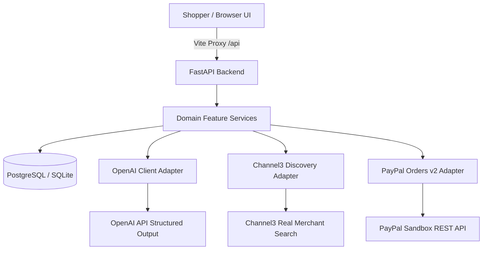

# BuyNexa

> **AI Shopping Copilot & Agentic Commerce Experience**  
> Built for the PayPal AI Hackathon 2026.

BuyNexa helps people make better online shopping decisions when they know what they need but do not know which product to buy. A shopper describes a goal in everyday language; BuyNexa turns it into a structured shopping brief, searches real product data through Channel3, compares relevant options against the shopper's criteria, and explains trade-offs using evidence from product records.

The product also demonstrates a complete PayPal Sandbox payment journey through a separate, clearly labelled BuyNexa Sandbox Store demo catalog.

---

## Architecture Overview

BuyNexa is structured as a modular single-repository containing two applications:

- **`frontend/`**: React 19 + TypeScript + Vite + Tailwind CSS + Lucide Icons.
- **`backend/`**: Python 3.12 + FastAPI + async SQLAlchemy 2.x + Pydantic v2 + Alembic + OpenAI Python SDK.



### Trust & Security Boundaries

1. **Anonymous Sessions**: Shoppers are issued cryptographically secure opaque tokens via `HttpOnly`, `SameSite=Lax` cookies. The server persists only SHA-256 hashes in the database.
2. **Discovery vs. Checkout**: Channel3 products are external retailer listings that link out to third-party stores. When user shopping requirements match BuyNexa Store demo catalog items, those items are surfaced with a distinct `BuyNexa Store — PayPal Sandbox Checkout` badge and can be added directly to the cart for instant PayPal Sandbox checkout, while external offers retain direct retailer links.
3. **Evidence-Grounded AI**: The AI extracts structured intent (`ShoppingBrief`) and summarizes factual product evidence. The model never sets prices, approves payments, or captures orders.
4. **Server-Authoritative Pricing**: Cart totals and line items are calculated in integer minor units from database catalog pricing upon order creation.

---

## Implemented User Journeys & Screens

| Screen | Route | Description | Backend Endpoint |
| :--- | :--- | :--- | :--- |
| **1. Shopping Landing** | `/` | Hero, natural language prompt composer, curated example prompts, and trust disclosures | `POST /api/v1/briefs` |
| **2. Brief Extraction** | Inline | Intentional multi-phase loading status transitions while extracting constraints | `POST /api/v1/briefs` |
| **3. Brief Review** | `/search/:briefId` | Editable criteria: category, use cases, budget mode, must-haves, preferences, exclusions | `GET/PATCH /api/v1/briefs/{id}` |
| **4. Discovery Results** | `/search/:briefId/results` | Ranked product cards with fit scores, evidence bullets, missing specs, and retailer links | `POST /api/v1/search` |
| **5. Product Comparison** | `/compare` | Side-by-side specification alignment matrix (up to 3 products) with sticky headers | `POST /api/v1/compare` |
| **6. Demo Store** | `/demo-store` | Sandbox store catalog items with add-to-cart controls and clear test disclaimers | `GET /api/v1/demo-catalog` |
| **7. Server Cart** | `/cart` | Line items, quantities, and server-authoritative subtotal/totals in integer minor units | `GET/POST/PATCH/DELETE /api/v1/cart` |
| **8. PayPal Checkout** | `/checkout` | Official PayPal JavaScript SDK buttons with server-side Orders v2 order creation | `POST /api/v1/payments/paypal/orders` |
| **9. Order Confirmation** | `/orders/:orderId` | Verified order receipt with PayPal capture reference and Sandbox disclaimer | `GET /api/v1/orders/{orderId}` |

---

## Repository Structure

```text
buy-nexa/
├── frontend/                     # React + TypeScript + Vite frontend
│   ├── src/
│   │   ├── app/
│   │   │   ├── router.tsx        # Typed client router supporting all 9 routes
│   │   │   └── routes/           # Page routes (home, brief, results, compare, store, cart, checkout, order)
│   │   ├── components/
│   │   │   ├── ui/               # Reusable primitives (button, input, textarea, badge, card, skeleton)
│   │   │   ├── layout/           # AppShell, responsive Navbar, and Footer
│   │   │   ├── brief/            # PromptComposer and BriefEditor
│   │   │   ├── shopping/         # ProductCard with evidence and fit score badges
│   │   │   ├── comparison/       # Responsive ComparisonTable (modern-web-guidance compliant)
│   │   │   └── checkout/         # PayPalCheckoutButton with dynamic SDK loading
│   │   ├── features/
│   │   │   ├── cart/             # CartProvider and cart hooks
│   │   │   └── comparison/       # ComparisonProvider with session persistence
│   │   ├── lib/
│   │   │   ├── api-client.ts     # Centralized typed HTTP client with error handling
│   │   │   ├── formatters.ts     # Currency (minor units) and score tier formatters
│   │   │   └── utils.ts          # Tailwind utility merging and ID helpers
│   │   ├── types/                # TypeScript domain models (brief, product, cart, payment)
│   │   └── test/                 # Test suites (App, formatters, comparison, router)
│   ├── package.json
│   ├── vite.config.ts            # Configured with /api proxy to FastAPI (port 8000)
│   └── vitest.config.ts
├── backend/                      # Python + FastAPI backend
│   ├── alembic/                  # Versioned database migrations
│   │   └── versions/             # Migration scripts
│   ├── app/
│   │   ├── api/
│   │   │   ├── deps.py           # Dependency injection for session and DB
│   │   │   └── v1/
│   │   │       ├── endpoints/
│   │   │       │   ├── health.py # /api/v1/health/live & /api/v1/health/ready
│   │   │       │   ├── briefs.py # /api/v1/briefs (POST, GET, PATCH)
│   │   │       │   ├── search.py # /api/v1/search & /api/v1/compare
│   │   │       │   ├── catalog.py# /api/v1/demo-catalog
│   │   │       │   ├── cart.py   # /api/v1/cart (GET, POST, PATCH, DELETE)
│   │   │       │   └── payments.py# /api/v1/payments/paypal/orders & capture
│   │   │       └── router.py
│   │   ├── core/                 # Settings, structured logging, errors, security
│   │   ├── db/                   # SQLAlchemy declarative models & async session
│   │   ├── features/             # Business feature services & repositories
│   │   ├── integrations/         # External provider adapters (OpenAI, Channel3, PayPal)
│   │   ├── schemas/              # Pydantic boundary contracts
│   │   └── main.py               # FastAPI entrypoint, middleware, exception handlers
│   └── tests/                    # 25 automated pytest tests
├── .env.example                  # Environment configuration template
├── AGENTS.md                     # Engineering and contributor guidelines
├── Architecture.md               # Detailed system architecture document
├── Product.md                    # Product specification document
└── LICENSE                       # MIT License
```

---

## Local Development & Setup

### 1. Prerequisites

- **Node.js 20+** and **pnpm**
- **Python 3.12+** and **uv**

### 2. Environment Configuration

Copy `.env.example` to `backend/.env` and configure your credentials:

```bash
# Server-only credentials (never exposed to frontend)
DATABASE_URL=sqlite+aiosqlite:///buynexa.db
OPENAI_API_KEY=your_openai_api_key
OPENAI_MODEL=gpt-4o-mini
CHANNEL3_API_KEY=your_channel3_api_key
PAYPAL_CLIENT_ID=your_paypal_sandbox_client_id
PAYPAL_CLIENT_SECRET=your_paypal_sandbox_client_secret
PAYPAL_BASE_URL=https://api-m.sandbox.paypal.com
```

In `frontend/.env`:
```bash
VITE_PAYPAL_CLIENT_ID=your_paypal_sandbox_client_id
```

### 3. Starting the Applications

#### Terminal 1 — FastAPI Backend:
```powershell
cd backend
uv run python -m uvicorn app.main:app --reload --port 8000
```
- Interactive Swagger API documentation: [http://localhost:8000/docs](http://localhost:8000/docs)
- OpenAPI JSON Schema: [http://localhost:8000/openapi.json](http://localhost:8000/openapi.json)

#### Terminal 2 — React Frontend:
```powershell
cd frontend
pnpm dev
```
- Access the web interface at [http://localhost:5173](http://localhost:5173). All `/api` calls are seamlessly proxied to the FastAPI server.

---

## Verification & Testing

### Backend Quality Gates
```powershell
cd backend
uv run python -m ruff check .          # Linting
uv run python -m ruff format --check . # Formatting check
uv run python -m pytest -v             # 25 automated tests
```

### Frontend Quality Gates
```powershell
cd frontend
pnpm typecheck                         # Strict TypeScript compiler verification
pnpm test                              # 27 automated Vitest unit/component tests
pnpm build                             # Production bundle build
```

---

## License & Sandbox Disclosure

This project is licensed under the MIT License.

**Notice:** BuyNexa is an AI Hackathon project. The demo store and PayPal checkout operate solely against the PayPal Sandbox testing environment with no real monetary transfers and no fulfillment. External product listings link out to live third-party retailers.
